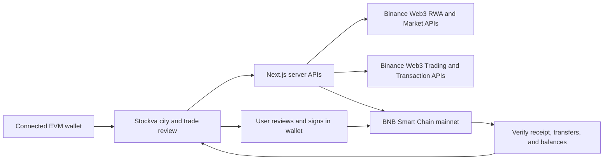

# Stockva — Build a City from Your Stock Portfolio

**A visual tokenized-stock portfolio and spot-trading app on BNB Smart Chain.**

Built for **BNB Hack: Tokenized Stocks Edition**, the online BNB Chain and Binance Web3 Wallet hackathon. Stockva turns real wallet holdings into an isometric city: buy an issuer stock token with USDT, place its company building after the balance confirms, then sell the token back into USDT in the same wallet.

[Repository](https://github.com/rikokurnia/stockva-bnb) · [Official hackathon](https://www.bnbchain.org/en/hackathons/tokenized-stocks?tab=resources) · [Submission checklist](docs/hackathon-checklist.md) · [Mainnet verification evidence](docs/mainnet-readiness.md)

## Why Stockva

A list of tickers and balances can make a first on-chain stock purchase feel abstract. Stockva gives those holdings a visual home while keeping the actual asset, issuer, price, and transaction visible.

- **Build your portfolio city.** Company buildings represent confirmed stock-token holdings in your wallet. Roads and civic services are free visual features.
- **Discover exact issuer tokens.** bStocks is the primary integration and default issuer when available; Ondo expands discovery coverage. Different issuers of the same underlying stock keep separate contracts and prices. xStocks appears only if the live BSC catalogue lists it.
- **Buy and sell with real USDT.** Review a wallet-specific quote, simulate the transaction, sign in your wallet, and follow confirmation through City Hall.
- **Research before trading.** Inspect available token prices, history, and company research. The optional Cokoo advisor provides analysis; each trade requires your own wallet signature.

The city is a view of your portfolio. Removing a building changes its visual placement; selling tokens is a separate reviewed trade.

## BNB Hack integration

Stockva enters the **Tokenized Stocks Products & Agents** main track as a portfolio and trading interface. Issuer stock tokens are the assets users discover, hold, buy, and sell.

| Integration                  | How Stockva uses it                                                                                 |
| ---------------------------- | --------------------------------------------------------------------------------------------------- |
| Binance Web3 RWA Data API    | Discover BSC issuer contracts and retrieve stock, issuer, and reference information.                |
| Binance Web3 Market API      | Retrieve token-price observations and available candlesticks for the selected contract.             |
| Binance Web3 Trading API     | Request exact-token, exact-wallet spot quotes, approvals, and unsigned execution data.              |
| Binance Web3 Transaction API | Require transaction simulation before wallet execution.                                             |
| BNB Smart Chain              | Read real balances and verify transaction receipts and token transfers on mainnet, chain ID **56**. |
| Privy and viem               | Connect the user's EVM wallet, request signatures, and interact with BSC.                           |

Wallet balances come from BSC RPC. The Cokoo advisor is advisory only; Agentic Wallet, Wallet Skills, and BNB Agent Studio are not implemented integrations.

Market prices refresh every 15 seconds through the timestamped Binance Market API, in batches of at most 100 contracts. Observation times stay separate from retrieval times; stale prices and failed refreshes stay visible. Charts fetch up to 100 actual candles for each 1H / 1D / 1W view and preserve token/underlying source errors separately. Verified issuer metadata is cached for up to ten minutes; every trade still requires a fresh executable quote and simulation.

The default research catalogue follows the equity holdings of **iShares OEF**, an S&P 100 tracking fund. The bundled published snapshot is dated **6 October 2026**, with 100 companies and 101 share classes (both Alphabet classes). The server attempts a daily holdings refresh and retains the dated snapshot on failure. This is a fund-holdings reference, not a direct index-constituent feed. It stores identities and sectors, never fallback prices.

The read-only check on **8 October 2026 at 05:00 Asia/Jakarta** found BSC issuer tokens for **80 of those companies**, 488 verified contracts overall (46 bStocks, 442 Ondo, zero xStocks in that response), and valid timestamped market prices for all 488. These counts can change. A listed token does not establish an executable route. Companies without a verified token remain research-only and cannot be bought through a fabricated contract.

Underlying equity references come from Yahoo Finance and are labelled **delayed**; SEC financials retain reporting and filing dates. Full real-time equity coverage for all 100 companies has not been established. Missing data stays unavailable, and underlying references never substitute for an executable token quote.

## Mainnet architecture



USDT and issuer tokens stay in the connected wallet. Existing issuer and routing contracts execute trades; Stockva does not require its own mainnet vault deployment. API credentials stay on the server. Encrypted, session-bound recovery tickets let the app recover reviewed orders across stateless requests, with receipts checked again before displaying a fill.

Execution currently supports the verified **LiquidMesh SWAP** route. Quotes must pass chain, issuer, router, expiry, fee, and price-impact checks. Approvals use the required amount rather than an unlimited allowance. RFQ execution remains unavailable until the complete vendor signing domain and order schema are verified. A discovered token is tradeable only when a supported route passes these checks.

## Run locally

Requirements: **Node.js 22.18 or newer**, npm, an EVM wallet, a Privy app, and Binance Web3 API credentials. Obtain Binance credentials through the [developer portal](https://web3.binance.com/en/dev-portal).

```bash
git clone https://github.com/rikokurnia/stockva-bnb.git
cd stockva-bnb
npm install
cp .env.example .env.local
```

Configure `.env.local` using [.env.example](.env.example):

| Variable                         | Purpose                                                                                                     |
| -------------------------------- | ----------------------------------------------------------------------------------------------------------- |
| `NEXT_PUBLIC_PRIVY_APP_ID`       | Required wallet login configuration. Allow the local and deployed origins in Privy.                         |
| `BINANCE_WEB3_API_KEY`           | Required server-side Binance Web3 access.                                                                   |
| `BINANCE_WEB3_API_SECRET`        | Required server-side request signing.                                                                       |
| `STOCKVA_TRADING_SESSION_SECRET` | Set a stable private secret for production order recovery; keep it identical across instances and releases. |
| `BSC_MAINNET_RPC_URL`            | Optional server RPC override; must resolve BSC mainnet, chain ID 56.                                        |
| `NEXT_PUBLIC_BSC_RPC_URL`        | Optional browser RPC override for BSC mainnet.                                                              |
| AI provider variables            | Optional Cokoo analysis; see the environment example.                                                       |

Keep real credentials out of Git. Only public configuration belongs in variables prefixed with `NEXT_PUBLIC_`. Missing provider credentials produce unavailable data rather than demo prices or balances.

```bash
npm run dev
```

Open [Stockva City](http://localhost:3000/city). Connect your wallet and select **BNB Smart Chain mainnet (56)**. Trading requires **BSC USDT** and **BNB for gas** in that same wallet.

BSC USDT contract: [`0x55d398326f99059fF775485246999027B3197955`](https://bscscan.com/token/0x55d398326f99059fF775485246999027B3197955).

## Judge walkthrough: buy → build → sell

1. Open `/city`, connect an eligible wallet, and check its actual BSC USDT and BNB balances.
2. Choose a stock token and inspect its issuer and exact contract address.
3. Request a small USDT purchase quote. Review expected and minimum receipt, fees, expiry, and any required approval.
4. Review the successful Transaction API simulation and sign the approval and purchase when requested. Confirm the actual token receipt and wallet balance.
5. Place the company's building in your city. Inspect the confirmed order and explorer link in City Hall.
6. Sell the confirmed token amount using a fresh quote and simulation. Sign, wait for confirmation, and check that USDT returned to the same wallet.
7. Keep the purchase and sale hashes and reconcile actual gas, returned USDT, and any remaining token dust.

An unsupported route, expired quote, failed simulation, or provider outage must show its error and stop execution. A quote or unsigned transaction build does not establish a completed trade.

## Verification and small-trade budget

```bash
npm test
npm run typecheck
npm run build

# Read-only provider checks; require configured credentials.
npm run check:market
npm run check:mainnet -- YOUR_WALLET_ADDRESS 0.5 1
```

These scripts do not sign or broadcast transactions. The mainnet checker probes small NVDAB buy quotes, unsigned builds, available simulations, and reverse-sell quotes. An approval may need confirmation before the funded swap itself can be simulated.

Recorded checks on **6 October 2026** passed all **69 production tests**, type checking, and the production build. Provider checks resolved 488 BSC issuer contracts and obtained $0.50, $1, and $2 NVDAB quotes, unsigned builds, and exact-approval simulations. These are historical observations; current availability and costs require a fresh check. See [the evidence and remaining live checks](docs/mainnet-readiness.md).

For a first test, a provisional funding target is **$1 in BSC USDT plus roughly $1 in BNB for gas** for an empty wallet. Funding is different from expenditure: selling should return the trade principal less fees, spread, slippage, market movement, and dust. Neither a universal minimum nor a complete round trip below $1 has been verified. Exchange withdrawal and bridge fees are additional.

To build alongside your own running development server, use a separate output directory:

```bash
STOCKCITY_NEXT_DIST_DIR=.next-production npm run build
STOCKCITY_NEXT_DIST_DIR=.next-production npm run start -- --port 3001
```

## Submission status

This repository contains the mainnet implementation. **Public Vercel deployment and a funded buy → sell round trip are pending.** No live purchase, token receipt, sale, or returned-USDT evidence is claimed yet.

| Deliverable                                   | Status                                                                               |
| --------------------------------------------- | ------------------------------------------------------------------------------------ |
| BSC mainnet app and Binance Web3 integrations | Implemented; local verification recorded.                                            |
| Repository                                    | Published as `stockva-bnb`; currently private and must become public for submission. |
| Public demo                                   | Vercel deployment planned; use the local judge instructions above meanwhile.         |
| Small live trade evidence                     | Pending wallet funding, signatures, and balance reconciliation.                      |
| Demo video                                    | Pending; optional but strongly recommended, maximum four minutes.                    |
| Developer Experience Report                   | Pending; must be written by the human builder from their actual experience.          |

The [official rules](https://www.bnbchain.org/en/hackathons/tokenized-stocks?tab=resources), rechecked **7 October 2026**, require a working Binance Web3 project, a central bStocks/Ondo/xStocks use case, BSC mainnet spot trading, transaction dry runs, and a small live demonstration. Submission also requires a public repository, a deployed link or judge instructions, and a Developer Experience Report. The report accounts for 25% of judging; AI-generated reports are not accepted.

Submissions close **11 October 2026 at 12:00 UTC / 19:00 Asia/Jakarta**. Keep the submitted repository, demo, and deployed link accessible through judging on **12–23 October 2026**. Confirm participant eligibility and complete the official forms through the event page.

See [the submission checklist](docs/hackathon-checklist.md) for remaining deliverables and [Vercel preparation](docs/vercel-deployment.md) for deployment settings. Import this repository into Vercel with the **repository root** as the project root and the Next.js preset. Configure production credentials, a stable recovery secret, and the deployed Privy origin before live verification.

## Project layout

| Path                          | Responsibility                                                                                   |
| ----------------------------- | ------------------------------------------------------------------------------------------------ |
| `app/`                        | Next.js pages and server API routes.                                                             |
| `components/mainnet-city.tsx` | Mainnet city, wallet, trade review, and order interface.                                         |
| `lib/mainnet.ts`              | BSC configuration, asset types, and RPC access.                                                  |
| `lib/trading-server.ts`       | Discovery, balance reads, quote/build/simulation validation, recovery, and receipt verification. |
| `lib/trading-client.ts`       | Wallet transaction execution and browser order recovery.                                         |
| `tests/`                      | Production safety, market data, trading, and UI logic checks.                                    |
| `scripts/`                    | Read-only provider and mainnet readiness checks.                                                 |
| `docs/`                       | Evidence, submission checklist, and deployment preparation.                                      |
| `contracts/`                  | Archived testnet simulation contracts; unused by the mainnet trading flow.                       |

The archived contracts accept caller-supplied prices and were built for freely minted mUSD. They must not custody real collateral or serve as the mainnet trading system. Historical checks remain available through `npm run test:legacy`.

**Stack:** Next.js 15, React 19, TypeScript, Privy, viem, Binance Web3 APIs, and lightweight-charts.
